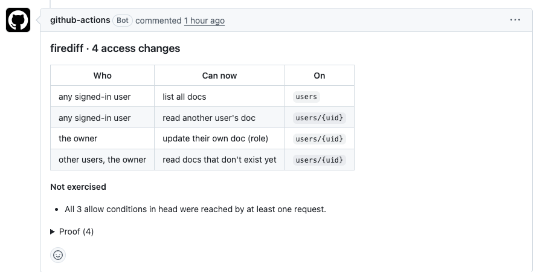

# firediff



This is the comment firediff posted on a pull request that changed `allow read: if isOwner(uid)` to
`allow read: if isSignedIn()` and dropped the update rule's guard on `role`.

**See who a Firestore security rules change just let in.**

firediff runs the old and new versions of your `firestore.rules` side by side in the Firestore
emulator. It sends both the same generated requests: signed-out users, strangers, owners, users with
custom claims or role docs. Then it reports only the requests whose allow/deny flipped. Every row
comes with a request you can replay. It's deterministic and doesn't use an LLM.

**[Try it in the browser →](https://firediff.amsozzer.com/)** No install: paste two rules files and compare.
The hosted playground takes small files (up to 150 generated requests, 5 s per comparison); for
bigger ones, run it locally.

## Requirements

- Node 22+
- Java 21, for the Firestore emulator (`brew install openjdk@21`, or `actions/setup-java` on CI)

On first use, firediff downloads the Firestore emulator (137 MB, checksum-verified) into
`~/.cache/firebase/emulators`, the same place firebase-tools keeps it. You don't need firebase-tools.
Set `FIREDIFF_EMULATOR_JAR` to use a jar you already have.

## Use it locally

```sh
# Compare two files
npx @amsozzer/firediff base.rules head.rules

# Compare a branch or commit with your working tree (reads the rules path from firebase.json)
npx @amsozzer/firediff --since main

# Paste two rules files into a local web page
npx @amsozzer/firediff playground   # http://127.0.0.1:8787/

# See the generated requests without running them
npx @amsozzer/firediff plan base.rules head.rules
```

The npm package is `@amsozzer/firediff`; installed with `npm i -g @amsozzer/firediff`, the command is
`firediff`. It's one bundled file with no dependencies. If `FIRESTORE_EMULATOR_HOST` is set,
firediff uses that emulator; otherwise it starts its own on free ports and stops it afterwards.

| Option | |
|---|---|
| `--format md\|json\|text` | Output format (default `md`). `json` includes the full request matrix. |
| `--fail-on gained\|any\|never` | Exit 1 when access was gained (default), on any change, or never. |
| `--strict` | Exit 2 when firediff could test fewer than half of the rules. |
| `--since <ref>` / `--rules <path>` | Compare `<ref>:<rules>` with the working tree. |
| `--config <file>` | Extra docs, claims, principals or payloads (default `./firediff.yml`). |
| `--json-out <file>` | Also write the JSON report. |
| `--comment` | Post the report as a sticky PR comment (in GitHub Actions). |

Exit codes: `0` no gained access, `1` gained access (see `--fail-on`), `2` couldn't run (parse
error, no Java, emulator or git failure).

## GitHub Action

```yaml
# .github/workflows/firediff.yml
name: firediff
on:
  pull_request:
    paths: ['firestore.rules', 'firebase.json', 'firediff.yml']

permissions:
  contents: read
  pull-requests: write   # for the sticky comment

jobs:
  firediff:
    runs-on: ubuntu-latest
    steps:
      - uses: actions/checkout@v4
      - uses: Amsozzer1/firediff@v0.1
```

The action compares the PR's base commit with the PR head. It posts one comment on the PR and
updates it on every push, writes the report to the job summary, and fails the check when access was
gained. It runs from the committed `dist/` bundle, so there's no install step: setup is Java 21 plus
the cached emulator jar.

| Input | Default | |
|---|---|---|
| `base` | the PR base commit | Ref or sha to compare against. |
| `rules` | from `firebase.json` | Rules file path. |
| `working-directory` | `.` | Where `firebase.json` lives. |
| `config` | | Path to a `firediff.yml`. |
| `fail-on` | `gained` | `gained`, `any` or `never`. |
| `strict` | `false` | Fail when fewer than half of the rules could be tested. |
| `comment` | `true` | Post or update the sticky comment. |
| `github-token` | `github.token` | Needs `pull-requests: write`. |

Outputs: `gained`, `lost`, `requests`, and `report` (path to the markdown).

## Reading the report

From top to bottom:

1. **Warning** (only if fewer than half the rules were ever true for a request), with a
   `firediff.yml` suggestion for the claims and docs those rules need.
2. **Changed in this PR, but never tested**: rules this PR changed that no generated request
   exercised. Review these by hand.
3. **Gained access**, ranked: anyone › any signed-in user › other users › claims and roles › owner-only.
   Writes rank above lists, and lists above single reads. Probes on docs that don't exist yet rank last.
4. **Time-limited rules**: test-mode rules (`request.time < timestamp.date(…)`) whose end date
   was added, removed or moved. firediff evaluates as if inside the window, so reports don't depend
   on the day you run them.
5. **Lost access** (collapsed).
6. **Accepted data changed**: the caller already had the operation, and only the payloads the rules
   accept changed (extra keys, types, sizes).
7. **Couldn't test**: flips that depend on something firediff can't provide, such as an App Check
   token or a profile doc it didn't seed. Each entry names the missing piece.
8. **Not exercised**: everything else that was never true, plus requests firediff knowingly doesn't try.
9. **Proof** (collapsed): per row, the replayable request and why the base side denied it
   (`denied by L13 isOwner(uid) (false)`).

firediff never says a change is safe. "No access changes" only covers the requests it sent.

## firediff.yml

```yaml
# Extra seed docs (merged over the generated ones)
docs:
  - path: orgs/acme
    data: { plan: pro }
# Extra claim values; each becomes a principal
claims:
  plan: [free, pro]
# Extra principals (omit uid for signed out)
principals:
  - name: support agent
    uid: u_support
    claims: { support: true }
# Extra payloads, sent by every principal
payloads:
  - op: update
    path: users/u_owner
    data: { role: admin }
```

## How it works

1. **Parse** both files with Firebase's ANTLR grammar into a rule model: full match paths,
   `read`/`write` expanded to get/list/create/update/delete, and functions inlined.
2. **Generate**, from both models together:
   - concrete paths (wildcards compared with `request.auth.uid` become the owner's id);
   - principals: signed out, stranger, owner, another user, one per claim literal, one per
     `get()`/`exists()` role, plus one combined principal per OR-branch that needs several of those at
     once (e.g. a verified owner with a profile doc);
   - seed docs;
   - requests: get, list, creates and single-field updates, with payloads varied by allowed value,
     type, size bound and `request.time`.
3. **Run** every request against two emulator projects, `fd-base-<hash>` and `fd-head-<hash>`, with
   identical seeds, restoring docs after each allowed write.
4. **Diff and report** the flips, grouped and ranked, plus coverage from the emulator's
   `ruleCoverage`.

## How well it works

From a study of 25 public repos and 323 commit pairs that touched `firestore.rules`, hand-labeled:

- **Precision**: 56 of 60 randomly sampled findings were real access changes (93%). The 4 errors
  were wording problems, and all four are fixed in v0.1.
- **Notable**: about 8% of real gains (4 of 49 in the random sample) looked like unintended
  widenings, e.g. a test-mode catch-all made permanent, or owner-only reads opened to everyone.
- **Recall**: firediff proves some changes and points at the rest. Of 33 real access changes the
  first version reported nothing for, v0.1 reports 13 (39%) as gained, lost or time-limit changes,
  and 2 more under "Accepted data changed". For 17 more, it can't build the request that would flip,
  so it names the changed rules under "Changed in this PR, but never tested". 1 stays silent.
  Together that's 32 of 33 (97%) reported or pointed at.
- **Run time**: median about 11 s per pair, p95 about 45 s, on a laptop.

Treat "Changed in this PR, but never tested" as part of the review. firediff tells you what it
didn't test; it doesn't hide it.

## Known limits

- Principals come from what the rules mention. A rule that needs a combination firediff doesn't
  build, or a lookup keyed on data it can't seed, shows up under "Changed in this PR, but never
  tested" or "Couldn't test" instead of as a row.
- List queries are unfiltered or filtered to the caller's own docs. Rules that only allow other
  query shapes are tested on the deny side only.
- Payload variety covers allowed values, the types the rules check, size bounds and `request.time`.
  Deeper validation (nested maps, regexes on fields) may need `firediff.yml` payloads.
- App Check and Storage rules aren't tested.

## Development

```sh
pnpm install
pnpm test             # unit tests (no emulator)
pnpm test:emulator    # everything, including the traps and golden reports
pnpm traps            # corpus/trap-*: hand-written expected flips
pnpm build            # tsup + ncc → dist/ (commit it; CI fails if it's stale)
```

To run the playground on a public server, see [deploy/README.md](deploy/README.md).

## Related

Same idea for Supabase RLS: [Lintel](https://github.com/Amsozzer1/lintel).

## License

firediff is MIT licensed (see `LICENSE`). `src/grammar/` holds Firebase's ANTLR grammar from
`@firebase/eslint-plugin-security-rules`. It keeps its Apache-2.0 license headers; see `NOTICE`,
`src/grammar/NOTICE` and `src/grammar/LICENSE`. The bundles in `dist/` include third-party
packages; their licenses are in `dist/*/licenses.txt`.
